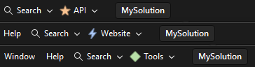
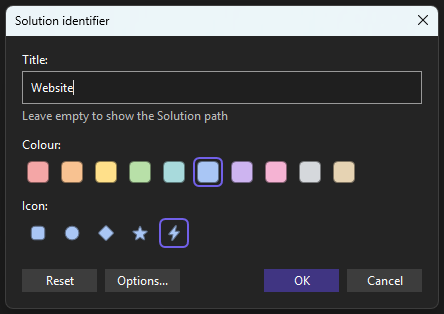
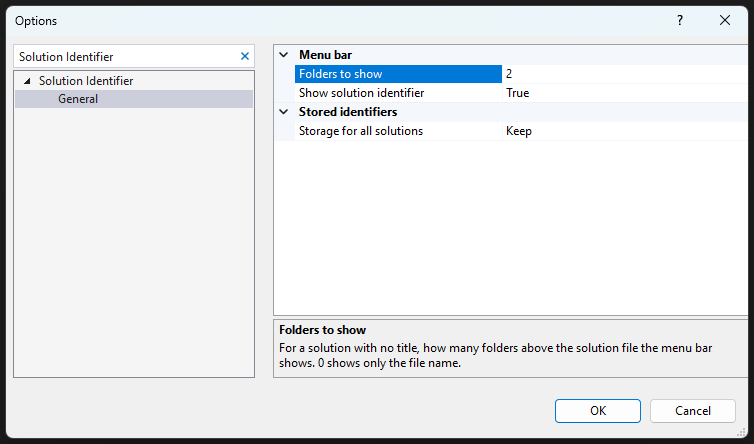

# Solution Identifier

Make your solutions more recognisable with coloured icons and a custom name on the menu bar.

Solutions can look very similar when you have multiple open at once, or work across many solutions regularly. With this extension you can assign a coloured icon and write your own title for each solution, or leave the extension to choose a selection for you and show the solution's path.

This screenshot shows three copies of one solution, each with a different identifier:

## Set an identifier

Click the identifier on the menu bar, or open its drop-down and choose **Change identifier...**.

- **Title:** the text to show. Leave it empty to show the solution file's path.
- **Colour:** one of 10 colours.
- **Icon:** a square, circle, diamond, star or lightning bolt.
- **Reset:** removes this solution's saved identifier. The menu bar goes back to the solution's path, with a colour and icon chosen automatically.
- **Options...:** opens the Solution Identifier options.

Each solution saves its identifier to `%LOCALAPPDATA%\SolutionIdentifier`. Visual Studio 2022 and Visual Studio 2026 share the same identifier for a single solution.

## Without a title

The menu bar shows the end of the solution file's path, for example `...\LocalRepo\Dev\MySolution.slnx`. The colour and icon are picked from the path, so different copies of a solution usually start with different ones.

## Options

**Tools > Options > Solution Identifier > General**

- **Folders to show:** for a solution with no title, how many folders above the solution file to show (0 shows only the file name).
- **Show solution identifier:** turn the identifier off completely.
- **Storage for all solutions:** choose **Clear** and click **OK** to delete every solution's saved identifier.

## Good to know

- Works with Visual Studio 2022 and Visual Studio 2026.
- Nothing is shown when no solution is open, when opening a folder instead of a solution, or for a new solution that hasn't been saved yet.
- Moving or renaming the solution file or its folder will reset its identifier.

## Licence

MIT
