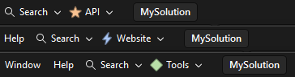

# Solution Identifier

**[Install from the Visual Studio Marketplace](https://marketplace.visualstudio.com/items?itemName=WilloAndCo.SolutionIdentifier)**

A Visual Studio 2022 and 2026 extension that shows a coloured icon and a name for the open solution on the menu bar, so solutions are easier to tell apart.

Click the identifier to choose a title, one of 10 colours and one of 5 icons. With nothing chosen, it shows the end of the solution's path, with a colour and icon picked from the path.

## How the extension works

### Changing the icon at run time

An extension can change a menu command's text and visibility at run time, but not its icon, which is fixed in the `.vsct` command table.

So the identifier is a split button (a button with a drop-down arrow) holding 50 hidden buttons, one per colour and icon, each with its own icon from `Resources\IdentifierIcons.png`. Only the button matching the current identifier is visible and checked, and `TextIsAnchorCommand` makes the split button show it.

### Showing on the menu bar

The split button is in the menu bar's window and help group (`IDG_VS_MM_WINDOWHELP`) with the highest priority number, so it sits at the end of the menu row. Visual Studio moves other extension buttons and menus on the menu bar into the Extensions menu, but a split button stays on the top row.

### Keeping colours in dark themes

On dark themes Visual Studio recolours menu icons: Lavender (#CDB4F0) showed as #5520A0. A cyan pixel at alpha 1 in each icon's top-right corner stops this.

The fix comes from a [Stack Overflow answer](https://stackoverflow.com/questions/37663993). The documented route, an image manifest with `AllowColorInversion="false"`, showed a blank icon.

### A default colour and icon from the path

For automatic colour and icon selection, a SHA-256 hash of the solution path picks one of the 50 pairs, so the same path always gets the same pair.

Other hashes tested gave less varied coverage of the colour and icon pairs across a wide range of paths.

### Storing data

Each solution's choices are one JSON file in `%LOCALAPPDATA%\SolutionIdentifier`, named by the hash of the path. Visual Studio 2022 and 2026 share the folder and the identifier data for a solution, so opening in either produces the same result.

An alternative would be to use Visual Studio's own settings store, but each Visual Studio installation keeps its own store, so identifiers are not synced across them.

### Supporting multiple Visual Studio versions

- **Old-style project file** - SDK-style extension projects are supported only from Visual Studio 2026 18.5.
- **Pinned build tools** - `Microsoft.VSSDK.BuildTools` 18.4.33 failed under Visual Studio 2022's MSBuild, so the project uses the older 17.14.2142, which builds for both.
- **Requires custom test framework** - Microsoft's extension testing framework (`microsoft/vs-extension-testing`) is archived and lists only Visual Studio 2012–2022. Its replacement in `dotnet/roslyn` targets only Visual Studio 2026, but there's no supported way to use it even for a 2026-only extension.
- **Separate Experimental instances** - each Visual Studio version has only one Experimental Instance for debugging, shared by the debugger and the integration tests. So they must be rebuilt and reset to be reused.
- **Tested on both** - every integration test runs against Visual Studio 2022 and 2026, and the tests can be run from either version.

## How it's tested

Test coverage is xUnit unit tests and a custom integration test setup. The integration tests run copies of Visual Studio 2022 and 2026 with the extension installed, and run tests against the live processes.

### Unit tests

xUnit tests for logic that doesn't need to run Visual Studio, such as shortening the solution path for the menu bar and picking the default colour and icon. They also check the hardcoded setup of buttons, matching the `.vsct` to the extension logic.

### Integration and UI tests

- **Integration tests** (`IdentifierButtonTests`) change Visual Studio's state directly, without the mouse. For example, testing that closing the solution hides the button.
- **UI tests** (`IdentifierDialogUITests`) click the button and use the dialog with the real mouse. For example, testing that a chosen title, colour, and icon show on the menu bar and are still there after the solution is reopened.

### Running the integration tests

Every test runs on Visual Studio 2022 and then 2026, one test at a time, in the Experimental instance (Exp) a separate copy of Visual Studio's settings and extensions used for testing extensions. `VisualStudioVersionFinder` finds the newest installation of each version with `vswhere.exe`, the Visual Studio Installer's command-line tool for listing installations.

1. **Prepare Exp** - build the extension and the "Inspector" into each version's Exp, and reset its settings.
2. **Copy** the sample solution into `%TEMP%`.
3. **Start** Visual Studio on the copy, with the ActivityLog error logging turned on.
4. **Connect** to its Development Tools Environment (DTE is Visual Studio's COM automation interface), wait for the solution and load the extension.
5. **Run the test**
6. **Clean up** - close Visual Studio, delete the copy and its saved identifier, and fail the test if the ActivityLog has errors that mention the extension.
7. **Reset Exp** after the last test, reset the experimental instance.

### Visual Studio Inspector

DTE can open and close solutions, check whether a solution has loaded, change Tools > Options settings and quit Visual Studio, **but it can't read a menu button's state**.

The Inspector is a small extension used only by the tests. It registers itself with DTE so the tests (which run in a separate process) can reach it and call its methods. Each menu button is a command in Visual Studio's command system, so the Inspector queries Visual Studio for a button's current state (visible, enabled, checked) and text with `IOleCommandTarget.QueryStatus`.

### Controlling Visual Studio

| Control | Used for |
| --- | --- |
| DTE over COM | Opening solutions and setting options. Calls are retried when Visual Studio is busy. |
| The Inspector, through DTE | Reading the menu buttons' state. |
| Windows UI Automation | Finding windows, dialogs and buttons. |
| Windows `SendInput` | Real mouse clicks, each checked first to be over Visual Studio's window. |

### Diagnosing hangs

If Visual Studio doesn't close when trying to exit, `StackReader` uses `cdb.exe`, the Windows SDK's command-line debugger, to read its main thread's call stack and see what has caused the hang.

### Results

Each test keeps its ActivityLog, `Failure.txt`, `Warning.txt` in a results folder for review.

## Building

Install Visual Studio with "Visual Studio extension development" enabled. Open and build `SolutionIdentifier.sln`, and F5 starts the Experimental instance with the extension.

The integration tests need Visual Studio 2022 and 2026 both installed.

| Project | Purpose |
| --- | --- |
| `SolutionIdentifier` | The extension. |
| `Tests\SolutionIdentifier.UnitTests` | Unit tests. |
| `Tests\SolutionIdentifier.IntegrationTests` | Integration and UI tests that start and control Visual Studio. |
| `Tests\SolutionIdentifier.VisualStudioInspector` | The extension the integration tests use to read state DTE can't. |
| `Tests\SampleSolutions` | A small solution for the integration tests to open. |

## Licence

[MIT](LICENSE.txt)
